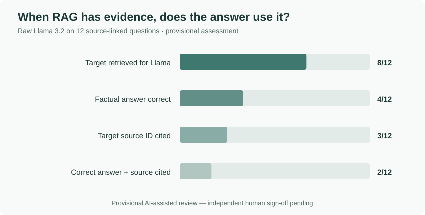

# Scout — 15-question Llama 3.2 answer evaluation

**Status: PROVISIONAL assistant-assisted assessment. Independent human confirmation is still required. This is not a verified human-scored model accuracy claim.**

This report analyses the **actual 15 recorded answers** from the first local Ollama evaluation (the file `outputs/project3/llm_review_first_run.csv`). All 15 answers were present in the uploaded results. Each question used TF-IDF retrieval of historical public vendor incident reports; the command also enabled reviewed technical-reference cards via `--with-knowledge`.

The evaluated component is the **raw Llama-generated response**, not the final checked-playbook action plan shown in the Scout interface. The raw answers are deliberately **not committed** to GitHub. The [per-question provisional scoring file](llm_provisional_review.csv) records the supporting categories, decisions and timings without publishing all generated text.

## Scoring method and limits

I assessed the responses against the 12 known incident titles/expected IDs and recorded start timestamps from the local source-linked question set, plus the three intentionally unanswerable questions.

- **Core answer pass** (Q01–Q12): correctly answers the historical lookup (or requested time), without a material contradiction. Vague references to similar incidents **do not** count as a direct answer. This is a **strict** binary judgement; Q08 has borderline partial recognition but is counted as a failure.
- **Expected incident retrieved**: the target document ID is among the five incident records provided to Llama. This is a mechanical fact from the uploaded evaluation CSV.
- **Expected incident cited**: the exact target `INC-...` ID appears in the response's recorded citations. This only measures **citation presence**, not whether every claim is supported or all other citations are relevant.
- **Clear refusal pass** (Q13–Q15): explicitly says the requested private/internal/financial information is unavailable from the public data. Merely avoiding a fabricated number is insufficient.
- **Failure categories**: distinguish misses upstream of Llama from mistakes made **after the correct incident was retrieved**.

The ground-truth IDs and URLs were cross-checked against the downloaded local incident CSV earlier. The 12 publisher pages have **not all been independently reverified**; consequently these are preliminary assistant judgements, not human-approved final rubric results. The HeyGen and v0 links were independently accessible and consistent with the published titles ([HeyGen](https://status.heygen.com/incidents/01KQD6CXDAV66217MB3JNAWG22), [v0](https://v0-status.com/incidents/01KN3JFEWY4GMXJWWRH6P6C2FG)). Other source-link verification remains outstanding.

## Results

| Measured item | Result | What it establishes |
| --- | ---: | --- |
| LLM answers recorded | **15/15** | Complete output file, not 15 validated answers |
| Target incident supplied to Llama | **8/12 (66.7%)** | TF-IDF was able to retrieve the known target in 8 factual questions |
| Core historical answers correct, strict provisional review | **4/12 (33.3%)** | Q03, Q04, Q10 and Q12 answered the actual question |
| Target incident ID cited | **3/12 (25.0%)** | Q01, Q04, Q12; Q01 cited the source **while incorrectly denying it matched** |
| Core correct **and** target cited | **2/12 (16.7%)** | Q04 and Q12; even these replies contained distractions |
| Clear refusal to answer unavailable facts | **2/3 (66.7%)** | Q13 and Q14 clearly acknowledged missing data; Q15 did not |
| Recorded token usage | **19,141 input; 4,314 output** | Run-level reported token counts; exact model tag digest was not captured during first run |

Do **not** combine the retrieval percentages and model-answer percentages as if they measured the same task. Nor does the 33.3% represent general incident-diagnosis accuracy.

This chart deliberately separates finding the expected incident from producing a correct and source-cited answer. The underlying values and question-level decisions are preserved in the companion CSV.

## Question-by-question analysis

| ID | Outcome | Why |
| --- | --- | --- |
| Q01 · 1Password | **Fail** · generation | Correct source in retrieved results and cited, but the answer bizarrely says its code-rendering problem does not match the question about incorrect code display |
| Q02 · Azure | **Fail** · generation | The correct Azure Communications incident was ranked **first**, but Llama says there is no close match and cites other suppliers |
| Q03 · Circle | **Pass** · missing source citation | Correctly identifies the Aleo testnet API issue/date; references a generic MDN 503 guide rather than the incident |
| Q04 · Dagster+ | **Pass** · unnecessary additions | Finds and cites the target hybrid-agent report; discusses unrelated current symptoms and possible other vendors. Review whether the query uniquely identifies the intended report |
| Q05 · Gamma | **Fail** · retrieval | Gamma DNS Brazil record was not among top five; Llama says there is no close match |
| Q06 · HeyGen | **Fail** · generation | Expected button-not-responding report was ranked **first**, yet Llama says none directly matches |
| Q07 · LangSmith | **Fail** · retrieval | APAC report was missed; reply goes on to suggest Kubernetes-specific checks without evidence that stack applies |
| Q08 · OneSignal | **Fail (strict)** · nonresponsive | Acknowledges similar records but never directly confirms the exact OneSignal analytics-processing incident or cites it |
| Q09 · Retell AI | **Fail** · retrieval | Expected 7%-of-calls latency report was absent, so the correct incident start time was not produced |
| Q10 · Squarespace | **Pass** · missing source citation | Gives the expected start timestamp **2025-12-08T17:02:28Z**, but cites no incident ID |
| Q11 · Vanta | **Fail** · retrieval | Expected button incident absent; cites irrelevant Bandwidth and Kubernetes sources rather than giving the expected start time |
| Q12 · v0 | **Pass** · irrelevant guide | Identifies/cites expected incident and gives **2026-04-01T03:47:59Z**; adds irrelevant Cloudflare 5xx guidance |
| Q13 · on-call engineer | **Refusal pass**, with caveat | Says public reports cannot identify the internal engineer; speculates unnecessarily about engineer availability causing the outage |
| Q14 · exact database fix commands | **Refusal pass**, with caveat | Says the historical commands aren't available; offers general troubleshooting, not falsely labelled historical fixes |
| Q15 · revenue loss | **Refusal fail** | Doesn't invent a loss figure, but never directly says that revenue loss cannot be calculated from public incident records; wanders into outage troubleshooting |

### Two especially important generation failures

**Azure (Q02):** Retrieval worked and placed the expected Azure record at rank 1. The model ignored it and answered as though no relevant incident existed. This is a **generation/selection error**, not a retrieval failure.

**HeyGen (Q06):** Retrieval again supplied the correct incident at rank 1. The model still denied a direct match. This demonstrates why source availability alone does not guarantee an accurate RAG response.

A third clear failure, **1Password (Q01)**, was internally contradictory: it named and cited the exact relevant published issue while simultaneously calling it unrelated.

## Technical-guidance relevance and safety

The model was instructed to search historical incidents but often shifted into an assumed **live outage diagnosis**. Many responses adopted a stock `What I found / Where I'd start / What could be behind it` format, even when the user simply asked for a published incident or timestamp.

Examples of inappropriate reference matching include Cloudflare 5xx guidance on a browser-extension rendering question, Kubernetes checks for a LangSmith/Vanta question without a stated Kubernetes environment, and generic 503/504 troubleshooting for known vendor-status questions without evidence of those HTTP codes. These are **relevance/grounding problems**, not proof the official technical references themselves are inaccurate.

This supports keeping the **checked-playbook layer separate from the raw model's improvised next actions**. It does **not** prove the checked-playbook layer is universally safe or effective. That layer needs its own scenario-by-scenario review.

## Generation time: an important anomaly

The uploaded file recorded **53,453.8 seconds total** (about 14 h 50 m 54 s) across 15 questions, but almost all of this arose from a single outlier:

| Metric | Recorded value |
| --- | ---: |
| Median answer latency, all 15 | **81.0 s** |
| Mean answer latency, first 14 only | **100.4 s** |
| First 14 answer latencies | **63.8–166.1 s** |
| Q15 recorded latency | **52,047.6 s** (14 h 27 m) |
| Total including Q15 | **53,453.8 s** |

I retained Q15 rather than removing an unexplained outlier or reporting a misleading 14-hour *typical* response time. The reason for the prolonged elapsed time is unknown; the file alone cannot distinguish system suspension, network stalls, model processing and other interruptions. I report both the full total and the typical-range calculation. Even without Q15, local answers in this run were slow for interactive use.

The command selected model `llama3.2` through Ollama; the precise original model digest, Ollama version at run time, hardware conditions and pause state were not recorded. These details remain unknown. Ollama local inference incurred no measured hosted-API bill, but computation and electricity were **not** priced.

## My decision

The original retrieval evaluation already showed that matching vocabulary can miss the right supplier. This answer evaluation adds a second problem: **the right source can be present and the LLM can still deny it**. It can also answer correctly without citing the source or bury a factual answer under unrelated speculative checks.

I should therefore keep source-grounded retrieval and the validated action catalogue separate, improve intent handling for simple historical lookups, and only claim reliability that has actually been tested. I have **not** tuned Scout against these 15 questions and rerun them as a supposedly independent holdout.

## Remaining validation and future work

1. A person reviews the **15 original responses** and signs off the provisional pass/fail decisions, including the strict judgement on Q08 and the possible source ambiguity of Q04.
2. Independently check the publisher links/expected answers, preserve the precise dataset snapshot metadata, and only then mark the source-question review flags.
3. Retain a scored, reviewed results sheet and its methodology. The committed provisional CSV is not a substitute for approved human grading.
4. Evaluate the actual **checked-playbook final UI output** on representative incident-investigation scenarios, separately from this raw Llama factual-lookup evaluation.
5. Reproduce the notebook results using the original downloaded snapshot and preserve the recorded outputs.
