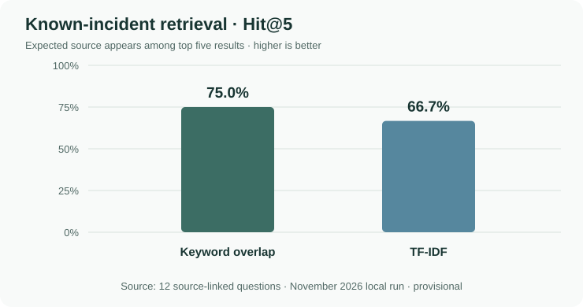
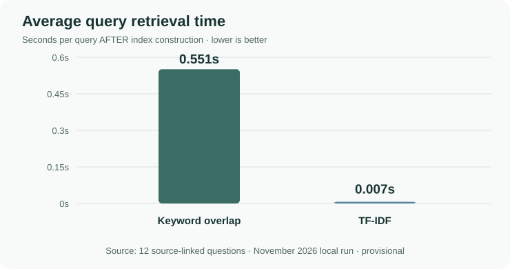

# Scout retrieval evaluation — recorded results and error analysis

**Status: provisional observed result, not an independently frozen holdout.**

This report preserves the actual terminal results from the first 15-question evaluation conducted locally in November 2026 on the downloaded SevAnalysis `incidents.csv`. The CSV question set was generated and then manually reworded before the run. The 12 expected document IDs and URLs were matched to records in the downloaded dataset. **The original vendor webpages were not all independently inspected**, and the `reviewed_by_human` flags in the local question set had not been approved.

The raw retrieved rankings and exact time per query are in the local file `outputs/project3/retrieval_evaluation.csv`, which is ignored by Git. This committed report is a faithful **summary of the reported terminal metrics and five investigated miss examples**, not a substitute for the raw file. To make the complete evidence visible in GitHub, the local file should be copied into a reviewed `reports/` artefact after checking it does not contain private material.

## Measured results (12 answerable questions only)

| Method | Expected record within first 5 | Hit@5 | Mean retrieval latency |
| --- | ---: | ---: | ---: |
| Keyword overlap | 9 / 12 | **75.0%** | **0.551 s** |
| TF-IDF words and bigrams | 8 / 12 | **66.7%** | **0.007 s** |

Three additional questions, Q13–Q15, were deliberately outside the data's scope. They are **not included** in the Hit@5 denominator; their refusal behaviour must be scored separately with the LLM.

**Interpretation:** In this small evaluation, keyword overlap retrieved one more of the expected incidents. TF-IDF returned results much faster. This comparison measures search time **after indexing**; it does not include building the TF-IDF matrix or loading the CSV, and the two implementations have different computational costs. No statistical significance or general accuracy advantage is claimed.

## Figures included in the assessment evidence





The two charts use the exact measured figures reported above. They are descriptive comparisons, not proof of statistical significance.

## Record-by-record evidence

The [companion CSV](retrieval_baseline_2026-11.csv) preserves whether each method retrieved the expected document at rank 1–5. We reviewed the actual top three result titles for the five questions missed by at least one method:

| Question | Keyword | TF-IDF | What the returned titles showed |
| --- | --- | --- | --- |
| Q02 · Azure Communication Services | Miss | Hit, ranked first | Keyword preferred Palo Alto, Couchbase and JFrog incidents concerning Azure outages, not Azure's own service-status record |
| Q05 · Gamma DNS in Brazil | Hit, ranked first | Miss | TF-IDF preferred RubyGems DNS problems, Grafana's AWS DNS outage and Kraken transaction problems |
| Q07 · LangSmith APAC queries | Miss | Miss | Results were about other vendors in geographic regions; the query used Asia-Pacific but the target record uses APAC |
| Q09 · Retell AI call latency | Hit, ranked third | Miss | TF-IDF preferred general traffic/service degradation at other vendors |
| Q11 · Vanta support button | Miss | Miss | Both results were related to generic support or app incidents rather than Vanta's specific Chat with us button |

These failure descriptions were inspected manually from the retrieved title lists. Proposed causes (synonyms, abbreviations, weak supplier ranking) are **diagnostic hypotheses about the retrieval system**, not objectively proven root causes.

## What I learned and did not change

1. TF-IDF is a sensible, fast lexical retriever for the prototype, **not a proven accuracy improvement** over keyword overlap.
2. Similar words are not equivalent to the correct historical incident. Supplier, region, abbreviation and product-specific wording can matter more.
3. It would be misleading to tweak ranking against these same 12 questions and then advertise an improved holdout score. I kept the scores unchanged and documented the failure modes.
4. The next honest comparison would use independently written, held-out questions and possibly vendor-aware ranking or semantic retrieval.
5. These scores say **nothing** about the correctness of Llama 3.2's generated answers or Scout's checked playbooks. Those need separate evaluations.

## Reproduction

From the standalone Scout repo, using the same local downloaded CSV:

```powershell
python -m scripts.evaluate_incident_assistant
```

The script reads `evals/incident_eval_questions.csv` from the **local workspace**. It warns when the 15 questions lack completed human source review. If rerun with a newer publisher CSV or edited questions, scores may differ. For exact reproduction, preserve the reviewed question set, original CSV download metadata and raw per-query evaluation CSV.

**Notes for the final assessment:** The 15-question protocol is the evaluation design used in this project. The supplied end-to-end final-project brief requires explained metrics, EDA, justified choices and visible results; its text does not specifically mandate 15 questions.
